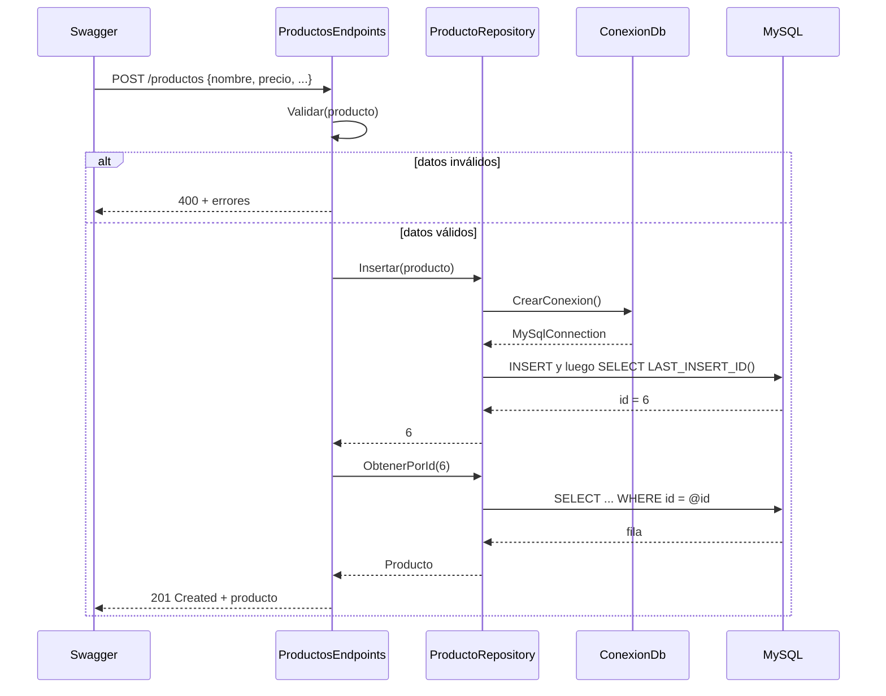

# ProductosAPI — CRUD de productos con ADO.NET y MySQL

Web API en **.NET 10 (Minimal APIs)** que administra un catálogo de productos
guardados en **MySQL**. Toda la comunicación con la base de datos se hace con
**ADO.NET** (conexión, comando, parámetros y lector), sin Entity Framework.
Se prueba desde **Swagger**.

Está armada con la misma estructura que `TareasAPI` (Models / Endpoints /
inyección de dependencias / Swagger / Docker), pero en lugar de guardar los
datos en una lista en memoria, ahora se guardan de verdad en una tabla.

**Alumno:** Marco Isai Martinez Moreno · UP230533 · ISC09C — UPA

---

## Puntos de la actividad y dónde están

| Punto a resolver | Dónde se resuelve | Endpoint |
| ---------------- | ----------------- | -------- |
| **Conexión**     | `Data/ConexionDb.cs` (`CrearConexion`, `ProbarConexion`) | `GET /conexion` |
| **Consultas**    | `ProductoRepository.ObtenerTodos()` y `ObtenerPorId(id)` | `GET /productos`, `GET /productos/{id}` |
| **Insert**       | `ProductoRepository.Insertar(producto)` | `POST /productos` |
| **Actualizar**   | `ProductoRepository.Actualizar(producto)` | `PUT /productos/{id}` |
| **Eliminar**     | `ProductoRepository.Eliminar(id)` | `DELETE /productos/{id}` |
| **Buscar**       | `ProductoRepository.Buscar(...)` (interfaz `IProductoBusqueda`) | `GET /productos/buscar` |

La interfaz que pide la actividad está **tal cual** en
`Repositories/IProductoRepository.cs`:

```csharp
public interface IProductoRepository
{
    List<Producto> ObtenerTodos();
    Producto? ObtenerPorId(int id);
    int Insertar(Producto producto);
    bool Actualizar(Producto producto);
    bool Eliminar(int id);
}
```

Como no trae un método para buscar, no la modifiqué: agregué otra interfaz
pequeña, `IProductoBusqueda`, y la misma clase `ProductoRepository`
implementa las dos.

---

## El modelo: `Producto`

| Propiedad       | Tipo C#    | Columna MySQL     | Tipo MySQL      |
| --------------- | ---------- | ----------------- | --------------- |
| `Id`            | `int`      | `id`              | `INT AUTO_INCREMENT` (PK) |
| `Nombre`        | `string`   | `nombre`          | `VARCHAR(100)`  |
| `Descripcion`   | `string`   | `descripcion`     | `VARCHAR(500)`  |
| `Categoria`     | `string`   | `categoria`       | `VARCHAR(50)`   |
| `Precio`        | `decimal`  | `precio`          | `DECIMAL(10,2)` |
| `Stock`         | `int`      | `stock`           | `INT`           |
| `Activo`        | `bool`     | `activo`          | `TINYINT(1)`    |
| `FechaRegistro` | `DateTime` | `fecha_registro`  | `DATETIME` (default `CURRENT_TIMESTAMP`) |

---

## Cómo funciona por dentro (explicado con mis palabras)

### La idea general

Pensé el proyecto en capas, donde cada una solo habla con la de abajo:

```
 Swagger / app móvil / Postman
            │   petición HTTP (JSON)
            ▼
 ┌──────────────────────────┐
 │ Endpoints                │  Recibe la petición, valida y decide qué
 │ ProductosEndpoints.cs    │  código HTTP regresar (200, 201, 204, 400, 404).
 └────────────┬─────────────┘
              │ llama a la interfaz IProductoRepository
              ▼
 ┌──────────────────────────┐
 │ Repositorio              │  Es la ÚNICA parte que escribe SQL.
 │ ProductoRepository.cs    │  Convierte filas de MySQL en objetos Producto.
 └────────────┬─────────────┘
              │ pide una conexión a IConexionDb
              ▼
 ┌──────────────────────────┐
 │ Conexión                 │  Guarda la cadena de conexión y fabrica
 │ ConexionDb.cs            │  objetos MySqlConnection.
 └────────────┬─────────────┘
              │ ADO.NET (MySqlConnector)
              ▼
          MySQL  →  base de datos productos_db, tabla productos
```

Los endpoints nunca ven SQL y el repositorio nunca ve HTTP. Si mañana
cambiara MySQL por SQL Server, solo tendría que rehacer el repositorio y la
conexión; los endpoints se quedan igual porque dependen de la interfaz, no
de la clase.

### Qué pasa cuando arranca la API (`Program.cs`)

1. **Se registran los servicios** (inyección de dependencias). Le digo a .NET:
   "cuando alguien pida `IConexionDb`, dale un `ConexionDb`" y "cuando pidan
   `IProductoRepository` o `IProductoBusqueda`, dale un `ProductoRepository`".
   - `ConexionDb` es **Singleton** (una sola para toda la app) porque solo
     guarda texto: la cadena de conexión.
   - `ProductoRepository` es **Scoped** (uno nuevo por cada petición).
2. **Se inicializa la base de datos** con `InicializadorDb.Inicializar()`:
   se conecta al servidor, hace `CREATE DATABASE IF NOT EXISTS`, luego
   `CREATE TABLE IF NOT EXISTS` y, si la tabla está vacía, mete 5 productos de
   ejemplo. Si MySQL está apagado no truena la API: solo deja un aviso en la
   consola y `/conexion` dice cuál fue el error.
3. **Se activa Swagger** (solo en Development): `MapOpenApi()` genera el JSON
   que describe la API y `UseSwaggerUI()` dibuja la página `/swagger`.
4. **Se mapean las rutas** (`MapConexionEndpoints` y `MapProductoEndpoints`)
   y `app.Run()` deja la API escuchando en `http://localhost:5135`.

### La conexión (`Data/ConexionDb.cs`)

- En el constructor lee `ConnectionStrings:MySql` de `appsettings.json`.
- `CrearConexion()` solo hace `new MySqlConnection(cadena)`. No la abre: el
  que la usa la abre con `Open()` y la cierra automáticamente con `using`.
- Abrir y cerrar en cada método no es lento porque ADO.NET tiene un **pool de
  conexiones**: al "cerrar" la conexión en realidad se regresa al pool y la
  siguiente petición la reutiliza.
- `ProbarConexion()` abre una conexión dentro de un `try/catch` y regresa la
  versión del servidor o el mensaje de error. Es lo que usa `GET /conexion`.

### La receta que repiten todos los métodos del repositorio

Todos los métodos de `ProductoRepository` hacen básicamente lo mismo:

1. `using var conexion = _conexionDb.CrearConexion();` y `conexion.Open();`
2. `new MySqlCommand(sql, conexion)` con la sentencia SQL.
3. Los valores van como **parámetros** (`@id`, `@nombre`...) con
   `comando.Parameters.AddWithValue(...)`. Nunca pego lo que manda el usuario
   dentro del texto del SQL; así MySQL lo trata como dato y no como código, y
   se evita la **inyección SQL**. (Lo probé buscando `' OR 1=1 --` y regresa
   una lista vacía, no toda la tabla.)
4. Se ejecuta con el método que corresponde:
   - `ExecuteReader()` → cuando espero filas (SELECT). Recorro con
     `while (lector.Read())`.
   - `ExecuteScalar()` → cuando espero un solo valor (el id nuevo).
   - `ExecuteNonQuery()` → cuando solo me importa cuántas filas se tocaron
     (UPDATE, DELETE).
5. Al salir del método, los `using` cierran lector, comando y conexión.

### Cada método

**`ObtenerTodos()`** — `SELECT ... FROM productos ORDER BY id`. Con
`ExecuteReader()` leo fila por fila; cada fila pasa por `Mapear()`, que toma
las columnas por nombre (`GetOrdinal("precio")`) y arma un `Producto`. Al
final regreso la lista.

**`ObtenerPorId(id)`** — igual, pero con `WHERE id = @id`. Si
`lector.Read()` da `false` es que no hubo fila, y regreso `null`. El endpoint
convierte ese `null` en un **404**.

**`Insertar(producto)`** — manda en un solo comando el `INSERT` y después
`SELECT LAST_INSERT_ID();`. Con `ExecuteScalar()` obtengo ese id (el que
MySQL generó con `AUTO_INCREMENT`), se lo asigno al producto y lo regreso.
El endpoint después hace `ObtenerPorId` con ese id para regresar la fila
completa (con la `fecha_registro` que puso MySQL) junto con un **201
Created**.

**`Actualizar(producto)`** — `UPDATE productos SET ... WHERE id = @id`.
`ExecuteNonQuery()` regresa cuántas filas coincidieron con el `WHERE`: si es
0 el id no existe y regreso `false` (el endpoint responde **404**); si es
mayor a 0 regreso `true` (**204 No Content**). El id que manda es el de la
URL, no el que venga en el JSON.

**`Eliminar(id)`** — `DELETE FROM productos WHERE id = @id`. Misma lógica que
actualizar: filas afectadas > 0 = sí existía y se borró.

**`Buscar(nombre, categoria, precioMin, precioMax, activo)`** — todos los
filtros son opcionales. Empiezo con `SELECT ... WHERE 1 = 1` y voy pegando
`AND ...` solo por los filtros que sí llegaron (el `1 = 1` es para no tener
que revisar cuál es el primero). El nombre usa
`LIKE CONCAT('%', @nombre, '%')` para que encuentre coincidencias parciales.
Aunque el SQL se arma dinámico, los **valores** siguen yendo como parámetros.

### Las validaciones (`ProductosEndpoints.Validar`)

Antes de llegar a la base de datos, el `POST` y el `PUT` revisan que el nombre
no esté vacío, que no se pasen los tamaños de las columnas, que el precio y
el stock no sean negativos. Si algo falla responden **400** con la lista de
errores por campo y ni siquiera se abre la conexión. En `/buscar` se valida
que `precioMin` no sea mayor que `precioMax`.

### Ejemplo de un recorrido completo: crear un producto



---

## Endpoints

| Método   | Ruta                  | Qué hace                             | Respuesta OK     | Errores |
| -------- | --------------------- | ------------------------------------ | ---------------- | ------- |
| `GET`    | `/conexion`           | Prueba la conexión con MySQL         | `200`            | `503`   |
| `GET`    | `/productos`          | Lista todos                          | `200` + lista    |         |
| `GET`    | `/productos/{id}`     | Uno por Id                           | `200` + producto | `404`   |
| `GET`    | `/productos/buscar`   | Filtra por `nombre`, `categoria`, `precioMin`, `precioMax`, `activo` | `200` + lista | `400` |
| `POST`   | `/productos`          | Crea uno                             | `201` + producto | `400`   |
| `PUT`    | `/productos/{id}`     | Reemplaza los datos de uno           | `204`            | `400`, `404` |
| `DELETE` | `/productos/{id}`     | Borra uno                            | `204`            | `404`   |

Ejemplo de JSON para `POST` / `PUT`:

```json
{
  "nombre": "Webcam Full HD",
  "descripcion": "1080p a 60 fps con micrófono",
  "categoria": "Periféricos",
  "precio": 699.00,
  "stock": 15,
  "activo": true
}
```

---

## Cómo ejecutarla

### Opción A — Con MySQL instalado en la computadora

1. Tener MySQL 8 corriendo (por ejemplo con MySQL Workbench / MySQL Installer).
2. Poner tu usuario y contraseña en `appsettings.json`:
   ```json
   "ConnectionStrings": {
     "MySql": "Server=localhost;Port=3306;Database=productos_db;User ID=root;Password=TU_PASSWORD;"
   }
   ```
3. Ejecutar:
   ```bash
   dotnet run
   ```
4. Abrir **http://localhost:5135/swagger**.

La base `productos_db`, la tabla y los datos de ejemplo se crean solos al
arrancar. Si prefieres crearlos a mano está el script
`Database/productos.sql`.

### Opción B — Todo con Docker (no necesitas instalar MySQL)

```bash
docker compose up --build
```

Levanta un contenedor de MySQL 8.4 (expuesto en el puerto **3307** para no
chocar con uno local) y la API en **http://localhost:5135/swagger**.
`docker compose down -v` borra también los datos.

---

## Cómo probarla

- **Swagger:** `/swagger` → abrir un endpoint → **Try it out** → **Execute**.
  Orden sugerido para la evidencia: `GET /conexion` → `GET /productos` →
  `POST` → `GET /productos/{id}` del nuevo → `PUT` → `GET /productos/buscar`
  → `DELETE` → `GET /productos/{id}` (debe dar 404).
- **`ProductosAPI.http`:** peticiones listas para VS Code (REST Client) o
  Visual Studio.

---

## Estructura

```
ProductosAPI/
├── Program.cs                       ← Arranque: servicios, inicializa BD, Swagger, rutas
├── Models/
│   └── Producto.cs                  ← Qué datos tiene un producto
├── Data/
│   ├── IConexionDb.cs               ← Contrato de la conexión
│   ├── ConexionDb.cs                ← Crea/prueba MySqlConnection (CONEXIÓN)
│   └── InicializadorDb.cs           ← Crea BD, tabla y datos de ejemplo
├── Repositories/
│   ├── IProductoRepository.cs       ← Interfaz de la actividad
│   ├── IProductoBusqueda.cs         ← Interfaz extra para BUSCAR
│   └── ProductoRepository.cs        ← Todo el SQL con ADO.NET
├── Endpoints/
│   ├── ProductosEndpoints.cs        ← Rutas /productos + validaciones
│   └── ConexionEndpoints.cs         ← Ruta /conexion
├── Database/
│   └── productos.sql                ← Script SQL de la base
├── Properties/launchSettings.json   ← Puerto 5135
├── appsettings.json                 ← Cadena de conexión
├── ProductosAPI.http                ← Peticiones de prueba
├── Dockerfile / compose.yaml        ← Docker (API + MySQL)
└── ProductosAPI.csproj              ← .NET 10 + paquetes
```

## Paquetes usados

- `MySqlConnector` — proveedor ADO.NET para MySQL (`MySqlConnection`,
  `MySqlCommand`, `MySqlDataReader`, `MySqlParameter`).
- `Microsoft.AspNetCore.OpenApi` — genera el documento OpenAPI.
- `Swashbuckle.AspNetCore.SwaggerUi` — la página `/swagger`.

> La contraseña `root` de `appsettings.json` y `compose.yaml` es solo para
> desarrollo local. En un servidor real iría en variables de entorno o en
> *user secrets*, nunca en el repositorio.

## Requisitos

- .NET 10 SDK
- MySQL 8 (o Docker Desktop)
